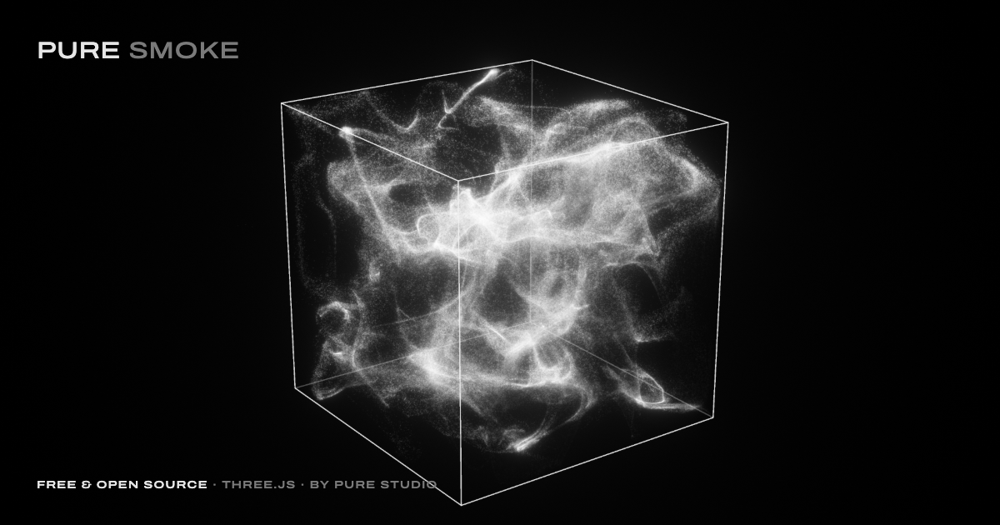

# Pure Smoke

Particle smoke in a glass cube. Free, open source and made with three.js.



**Play with it:** https://pure-smoke.vercel.app

Drag to turn the cube, hover to stir the smoke, scroll to zoom. Change the look with the panel on the side, then save a 4K image or record a seamless loop for your post.

## Controls

The panel shows the everyday choices first: a look, a colour, then save or share. Everything from **Smoke** to **Form** sits under **Fine-tune**, which stays open or closed as you left it.

| Group | Control | What it does |
| --- | --- | --- |
| Look | pure, aura, original, ribbon, veil, smoke | Starting points. **Pure** is the default: the clip's breath through a depth lens, with fine filaments, sharp grains and sealed glass. **Aura** is pure's breath a little softer and brighter, worn in dusk: a look can bring its colour, and takes it off again when a look without one follows (unless you changed the colour in between). **Original** is the reference clip's camera and red edges; **ribbon** (bright bands around a breathing body) and **veil** (slow sheets that fill the glass) are two other shapes for the same camera, each chosen by rendering it over 30 s. **Smoke** is the plain studio look. The looks are a list in the panel, the one on screen brighter with a check. **+ save this look** keeps the look on screen in the list as one of yours (mine 1, mine 2…, up to six, kept in this browser, with its colour unless that's an uploaded image); the one on screen shows **×** to remove it. **Download** keeps all of yours as a small file, and **upload** (or dropping that file on the page) brings them back, here or in another browser; uploading only adds, a look you already have is kept once, and six at most. To share a look, send the link in the address bar; **copy code** turns it into a preset for `src/settings.js`. **Randomize** rolls one of the smoke's three beautiful families (breathing **masses** like pure, slow crisp **silk** sheets, crisp **ribbons** around a breathing body) and varies it only inside the ranges where it stays beautiful. Those ranges were found by rendering rolls and scoring each frame: crisp strands rather than fog, shapes with air around them, the glass touched, no glare or gloom, coherent motion; 34 of 40 rolls pass that strict test (the rest are borderline), against 10 of 40 before. No roll adds spread, opens the glass or blurs the grains. **Reset** goes back to pure. |
| Colour | white, dusk, pearl, image | Two colours ship with the app, both by Pure Studio: **dusk**, a grain gradient (orange, pink, lilac, pale mint), and **pearl**, pearl orbs on black (pearl white, lilac, violet grey, with a blue and blush sheen). Each colour is an orb filled with its own colours; the one worn has a ring and its name by the title. **+ image** brings your own (or drop or paste one anywhere on the page; + image again swaps it), which joins as an orb of its own picture, and the smoke takes its colours like pigment in a fluid: every pixel becomes part of the smoke, each region of the cube wears one neighbourhood of the picture's colours, the flow folds the regions into strands, and a colour that covers 30% of the picture colours 30% of the smoke at every moment. Black (under 8% brightness) is left out: the smoke is light on a black studio, so the black around a picture is the studio itself. Under the orbs, the image's main shades show at their real shares. Switching between two colours turns every grain from its old colour to its new one. |
| Smoke | source | Not in the panel: where the smoke is born (wandering clouds, a plume at the bottom, or a core in the middle). With gather on, as in pure, the smoke is born at the gather centres and the source changes nothing you see; randomize sets it where it shows. Copy code includes it. |
| | flow | How fast the current moves. |
| | turbulence | How many small eddies ride on the big swirls. Calm smoke also turns in bigger rolls. |
| | spread | How much each grain wanders on its own, which puffs thin sheets out into soft volumes. |
| | gather | Pulls the smoke into bodies that chase two centres racing around the cube, so it moves as whole masses. |
| | pulse | The breath: every 1.994 s the masses swell until they fill the cube, then pull back in. |
| | escape | How much smoke finds its way out through the glass. Every look and randomize keep it at 0, so the smoke stays in the cube unless you open it yourself. |
| | rebound | How hard the smoke bounces off the glass. At 0 it settles against the faces; 50, every look's setting, springs back with 90% of its speed; 100 throws it back hard and far. |
| Light | brightness, shadows, glow, film grain | Exposure, how dense the smoke is to the light (how deep its shadows fall, and how much thick smoke hides what is behind it), the soft glow around it, and grain. |
| Particles | count | 65k, 262k, 500k, 1M or 2M grains. Computers start at 1M and step down to 500k if they can't keep 45 fps. |
| | size | How big each grain is. |
| | blur, focus | Depth of field: away from the focus plane grains open into soft discs with the same total light. Focus 0.5 is the middle of the cube; it rests (dimmed) while blur is 0, where it would do nothing. Every look and randomize keep blur at 0, so the grains stay sharp. |
| Form | spin, lens, edges | How fast the cube turns, a flat (orthographic) or depth lens (a change of lens crossfades from the last frame), and the edge colour. The edges are lit by the same lamp as the smoke, and smoke in front of them hides them. |
| Share | record, copy code | **Record** opens the record window in the panel's place. **Frame**: screen, 16:9, 9:16, 4:5 or 1:1; the canvas becomes that frame, fitted in the free space, so what you see is what is saved; **save image** saves it (4K on the long side). **Video**: 4, 8 or 16 s, a seamless **loop** or a single take (**once**), 30 or 60 fps, then **start recording** (1080 on the short side; see below). **Copy code** copies the current look as code, a preset ready to paste into `presets` in `src/settings.js`. The address bar always holds a link that opens with your settings. The S key saves the screen as you see it. |

Double-click a slider to reset it. Hold Shift while dragging for fine steps; arrow keys step by 1, Shift or Page Up/Down by 10. On a phone, a sideways drag sets a slider and a swipe up or down scrolls the panel. Every change goes into the address bar, so the link shares the exact look.

Keys: `Space` pause · `R` randomize · `S` save image · `H` hide the panel (the letters work wherever focus is; Space presses a focused button instead). Opening a link opens the look it holds; reloading the page starts again from pure.

Measured on an Apple M5 at 2560 × 1600: 1M grains take about 8 ms a frame, 2M about 23 ms. The lamp's two opacity maps add about 3 ms a frame at 1M (measured in a 560 × 1238 window).

### The loop

**Record** renders the video frame by frame instead of filming the screen, so every computer gets every frame (about 12 s for an 8 s loop at 60 fps and 1M grains on an M5; 30 fps takes half). The smoke always steps at 60 a second, as it does live; 30 fps keeps every other step. While it renders, the record window shows its progress and a cancel (or Escape); the frame shows the frames as they are made. A loop lasts whole breaths (the length asked for rounded to 1.994 s breaths: 8 s → 7.98 s; exactly the length when the smoke doesn't breathe), and the camera turns by whole quarter turns, because the glass looks the same every quarter turn: the original look's 501° become 540°, and a slow spin like pure's holds still for the loop. The last second crossfades into the first: a second simulation, started from the first frame's grains, replays that second under the end, so the last frame leads straight into the first. A single take keeps the length and the spin as they are. Rendering needs a browser with a video encoder (WebCodecs: Chrome, Edge, Safari 16.4+, Firefox 130+); others film the length in real time instead, without the loop. The MP4 is written by [mp4-muxer](https://github.com/Vanilagy/mp4-muxer) (MIT), loaded only when you record.

## The original look

The original look takes its camera and its breath from a reference clip (734 frames, 720 × 1280) of particle smoke in a turning wireframe cube, and its smoke and particles from pure.

- **Camera, exact.** Measured on every frame: an orthographic view looking 16.85° down, turning at 62.66° a second, with the cube's half-edge at 203 px on a 1280 px frame. When the look starts, its edges land on the clip's edges frame for frame.
- **Movement, measured frame by frame.** Every one of the clip's 734 frames was analysed at full resolution with optical flow, with the camera's own motion taken out. Each frame's vertical motion splits into a swell (spreading apart or squeezing together), a drift, a swirl in the picture's plane, and turbulence. Folded over its 12 beats (one every 1.994 s), the breath goes: a burst right after the smallest point, easing out into the glass; a float at the fullest, when the smoke is calmest; then a collapse that gets faster and twists, sinking as it swells and rising as it collapses, and a bounce straight back. The pulse plays those measured curves on the clip's clock, and gather holds the mass together only while it collapses. Measured inside the simulation, its swell follows the clip's through the beat at a correlation of +0.88; on the picture, the cube fills and empties on the clip's beats.
- **Always inside.** With escape at zero the glass is sealed: no grain ever leaves the cube.
- **Particles, pure's.** Fine strands of sharp grains, a soft glow and film grain, not the clip's. The smoke moves at pure's pace: at the clip's own speed the strands wash out into an even fog.

Use **9:16** to export in the clip's own frame.

## Run it locally

```bash
npm install
npm run dev
```

Then open http://127.0.0.1:5321. `npm run build` writes a static site to `dist/` that any host can serve.

## How it works

Every grain is one texel in two float textures (position and age, velocity and seed), updated on the GPU each frame with `GPUComputationRenderer`.

- **Flow:** curl noise built from the cross product of two simplex-noise gradients, in three octaves. It has no divergence, so the smoke folds and stretches without bunching up.
- **The glass:** the noise is multiplied by a ramp that reaches zero at the cube's faces (Bridson et al., *Curl-Noise for Procedural Fluid Flow*, 2007). Near a wall the flow can only run along it. Smoke that reaches the glass bounces straight back (with 90% of its speed at the default rebound) and splashes sideways along it, then rolls back inward instead of lying flat on the faces. Rebound sets the bounce, the kick and how long it carries: measured right at the glass, smoke leaves at 0.18 units a second at 0, 0.85 at 50 and 1.67 at 100. On screen, nothing is drawn past the cube's outline: each grain keeps its shape, and only the part of a dot beyond the glass is trimmed. Slow-moving holes let some smoke escape when escape is turned up.
- **Light:** one studio lamp, a point light up and to the left of the camera and a little in front of the cube, like the reference clip's key light. It turns with the camera, as if the cube turned under it. The light is physical: it falls off with the square of the distance, smoke between a grain and the lamp shades it, and smoke between a grain and the camera hides it. Both come from opacity maps (Kim & Neumann, *Opacity Shadow Maps*, 2001): every frame the grains are splatted into 16 depth slices of 64 × 64 seen from the lamp, and again seen from the camera, and each slice is summed with every slice in front of it. A grain reads how much smoke lies towards the lamp and towards the camera. On the reference clip's camera, the smoke comes out brighter on its top and left, as in the clip.
- **Image:** grains are drawn as soft dots into a float buffer (full floats where the GPU can blend them, so millions of faint grains add up without banding). Below 1.6 px they keep their size and lose brightness instead, so nothing shimmers. Bloom, a film-like highlight roll-off, grain and dithering finish the image.
- **Colours from an image, as data:** like Refik Anadol's data paintings, the picture's pixels are laid out on a 512 × 512 colour map where near means alike: hue across (starting at the hue the image has least of, greys last), light up within each hue. Each grain carries a place on the map like pigment, in a third simulation texture: two large, slowly drifting fields (hue and light) give each region of the cube its own neighbourhood of the map, and a grain eases toward its region's colour over about three seconds, so the flow drags colours into strands and folds. Every step, a sample of the grains (1 in 16) is sorted into a histogram of those fields on the GPU and its running sum evens them out, so every part of the map, and so every pixel, colours exactly its share of the smoke at every moment, wherever the smoke happens to be. Colour regions are large on purpose: a line of sight crosses few of them, so colours stay saturated instead of averaging to grey through the smoke. The film roll-off follows each pixel's brightest channel, so dense coloured smoke keeps its colour instead of bleaching to white.
- **Edges:** a plain stroke, one width end to end, drawn as anti-aliased screen-space strips after the grade, with round joins at the corners. Each point of an edge reads the same opacity maps as the grains and takes the light a grain would take there, through the same exposure and film roll-off: brightest nearest the lamp, darker away from it and where smoke shades it, and hidden by smoke in front of it.

All of it is in `src/`. Start with `settings.js` for the controls and looks, and `simulation.js` for the flow.

## Credits

- [three.js](https://threejs.org) (MIT)
- [mp4-muxer](https://github.com/Vanilagy/mp4-muxer) by Vanilagy, for the loop's MP4 (MIT)
- Simplex noise with gradients from [webgl-noise](https://github.com/stegu/webgl-noise) by Ian McEwan and Stefan Gustavson (MIT)
- Hash without Sine by Dave Hoskins (MIT)
- [Archivo](https://fonts.google.com/specimen/Archivo) and [Inter](https://rsms.me/inter/) (SIL Open Font License)

## License

[MIT](LICENSE): use it, change it, ship it. That covers the code and the two bundled colours, dusk and pearl. The Pure Studio name and logo are the studio's own and aren't part of the licence. The libraries, the noise code and the fonts keep their own licences, listed in [THIRD-PARTY-NOTICES.md](THIRD-PARTY-NOTICES.md).

---

Designed by [Pure Studio](https://www.purestudio.art/), a design studio for tech startups that need a brand and a landing page in a week.
